<div align="center">

**English** · [ไทย](README.th.md)

# SWIM — Staged Windows Image Manager

**Reimage a whole Windows computer lab over the network. No PXE, no USB sticks.**

[](LICENSE)


[Quick start](#quick-start) · [Screenshots](#screenshots) · [Architecture](#architecture) · [Installation guide](docs/INSTALL.md) · [Operations guide](docs/OPERATIONS.md)

</div>

SWIM builds a Windows image from a golden master VM on the server and installs it on client
machines one at a time, a room at a time, or on a schedule. Each client downloads the image
itself, verifies it, boots into WinPE, installs Windows and comes back online without anyone
walking to the machine.

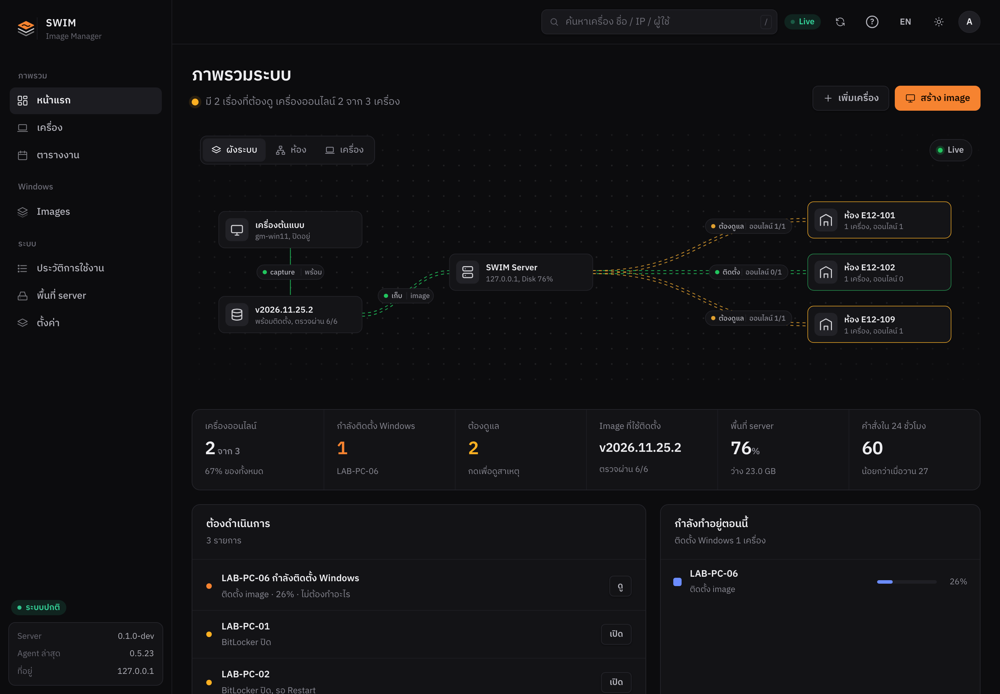

## Contents

- [Features](#features)
- [Screenshots](#screenshots)
- [Architecture](#architecture)
  - [Components](#components)
  - [Image pipeline](#image-pipeline)
  - [Reimage flow](#reimage-flow)
  - [Trust and security model](#trust-and-security-model)
- [Quick start](#quick-start)
- [Repository layout](#repository-layout)
- [What is not in this repository](#what-is-not-in-this-repository)
- [Documentation](#documentation)
- [License](#license)

## Features

- **Build images** from a golden master VM that runs on the server, or import an edition straight
  from a Windows ISO. SWIM runs sysprep, performs six offline checks and holds the image for
  approval before it can be installed.
- **Reimage over the network.** The client downloads the image, verifies its SHA-256, boots into
  WinPE, installs Windows and re-enrolls on its own.
- **Deploy at scale.** Select many machines or a whole room, schedule jobs on a calendar, and
  pre-stage images on clients ahead of time.
- **Manage machines** with 26 built-in tools (power, local users, programs, services, Windows
  Update, network, disk), in-browser Remote Desktop, Wake-on-LAN and an install-lock policy.
- **Audit everything.** Every action lands in a tamper-evident activity log, kept for 90 days.
- **Secure by design.** Sign-in uses a password plus an authenticator app (TOTP), and every command
  sent to a client is signed with Ed25519.
- **Bilingual console** in English and Thai, with dark and light themes.

## Screenshots

All screenshots are taken from the running application. Machine names, IP addresses and user
names were replaced with sample values.

| | |
|---|---|
| **Sign-in** with password and authenticator code | **Machine map** grouped by room, drag a machine to move it |
| 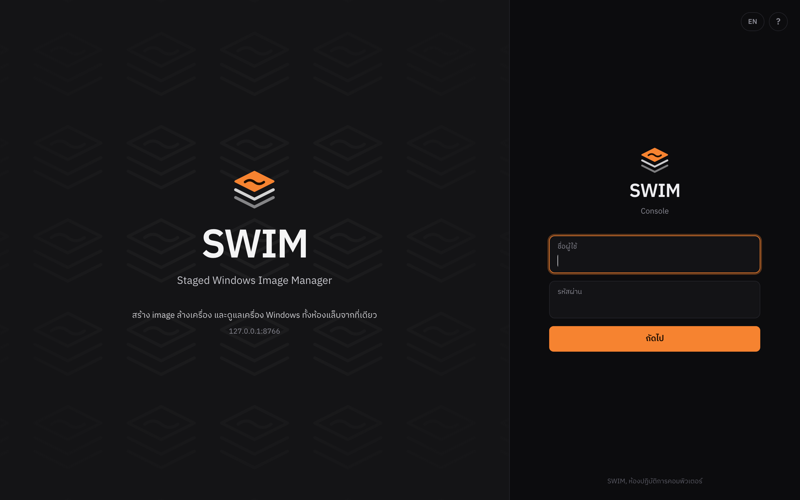 | 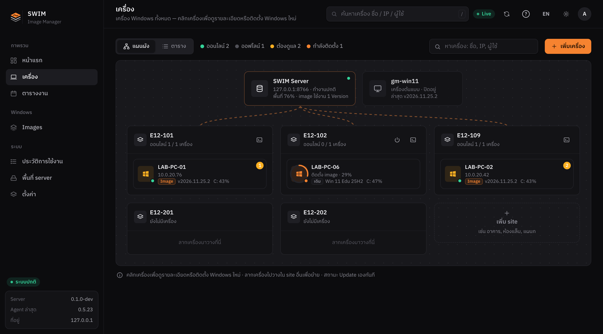 |
| **Machine list** with online status and installed Windows | **Images** and the golden master capture steps |
| 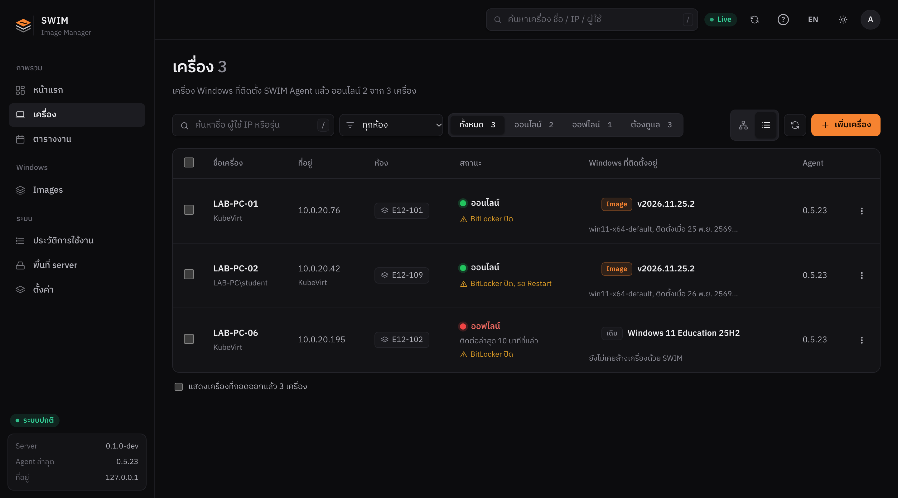 | 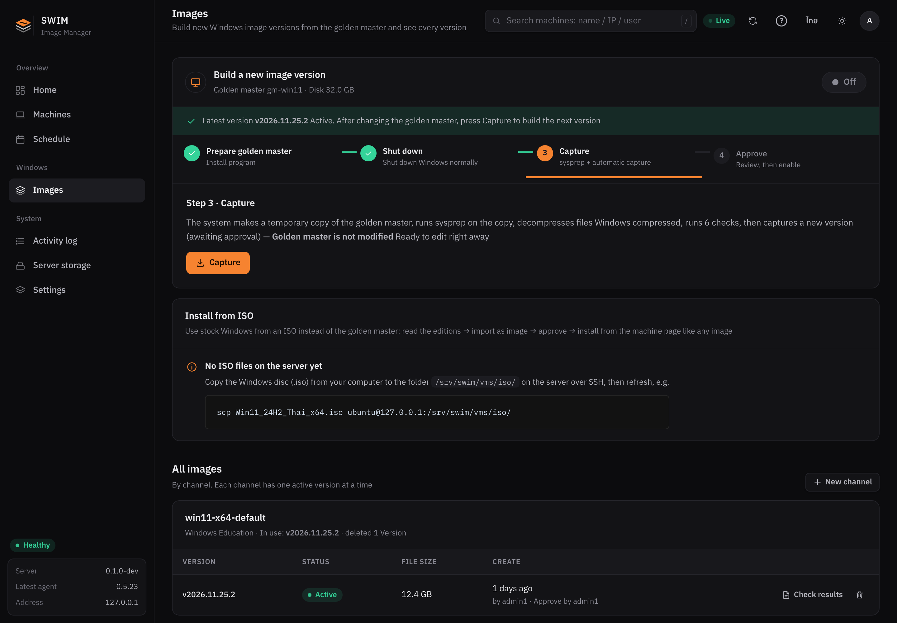 |
| **Machine page** with install policy and pre-staged image | **Tools** whose scripts are built and checked on the server |
| 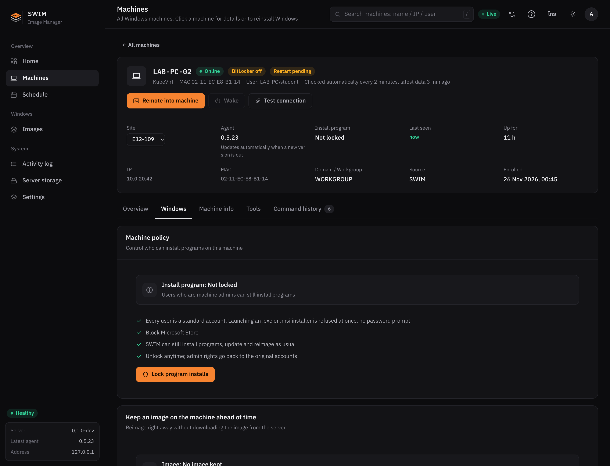 | 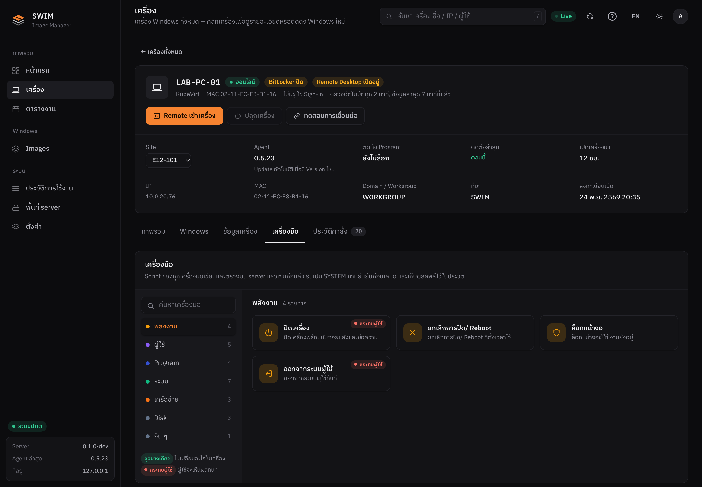 |
| **Schedule** reimage jobs ahead of time | **Activity log** of who did what, where and when |
| 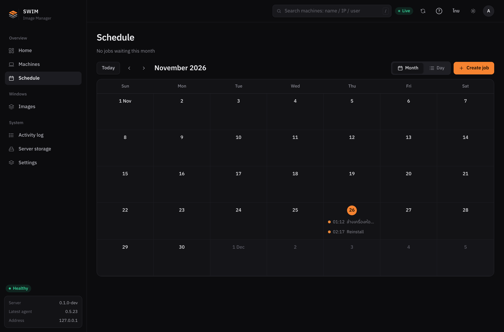 | 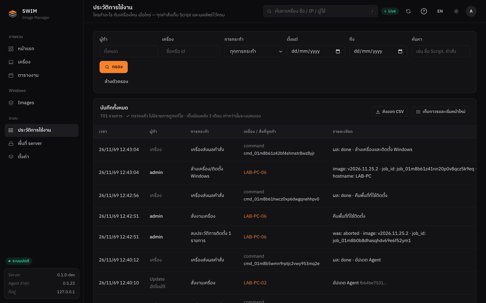 |

Light theme:

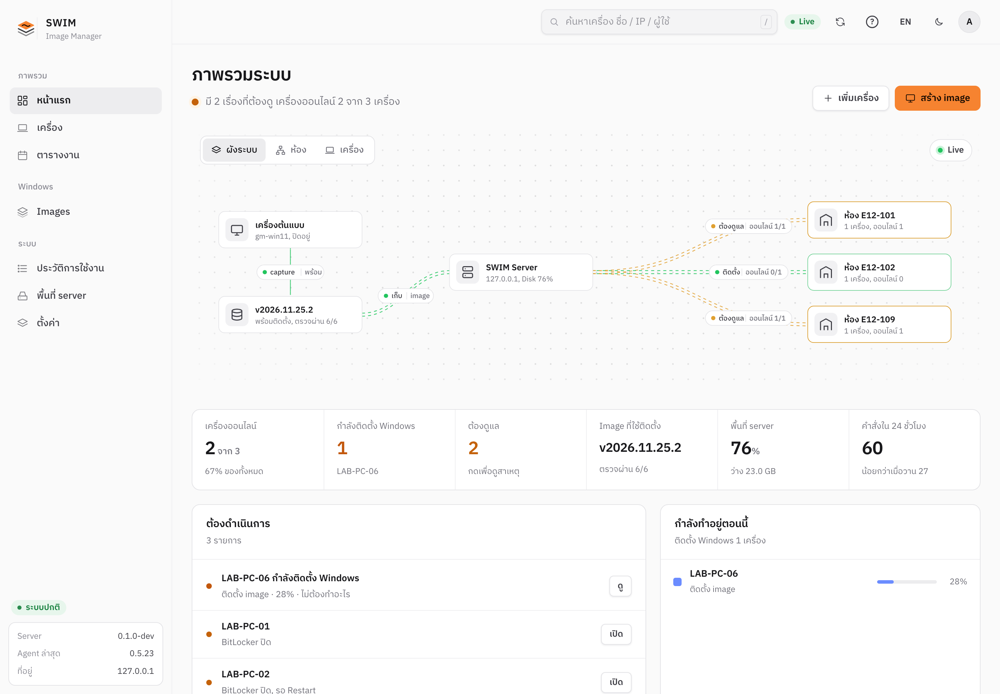

## Architecture

### Components

One server runs everything. The control plane lives in Docker Compose, and KVM/libvirt on the same
host runs the golden master VM. Only port 443 is exposed to the network (port 80 redirects to it);
internal services are not reachable from outside.

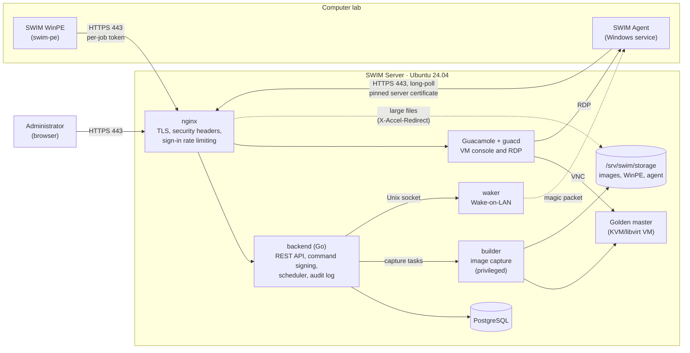

| Service | Role | Network |
|---|---|---|
| `nginx` | Single entry point. Serves the console, proxies the API and serves images the backend has authorised | 80, 443 |
| `backend` | The whole API: signs commands, runs schedules, writes the activity log | `127.0.0.1:8090` |
| `postgres` | Database. The application role cannot alter or delete activity log rows | Docker internal network |
| `builder` | Captures images and manages golden master snapshots | no ports |
| `guacamole`, `guacd` | Golden master console (VNC) and client Remote Desktop in the browser | `:8080` (blocked by the firewall), `127.0.0.1:4822` |
| `waker` | Sends Wake-on-LAN packets from the host network | Unix socket |

### Image pipeline

No image can be installed before an administrator approves it. Capture works on a temporary copy,
so the golden master itself is never modified.

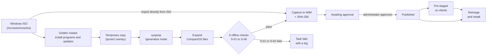

### Reimage flow

Everything is reversible until WinPE starts to partition the disk. If something goes wrong before
that point, the machine returns to its existing Windows with nothing changed.

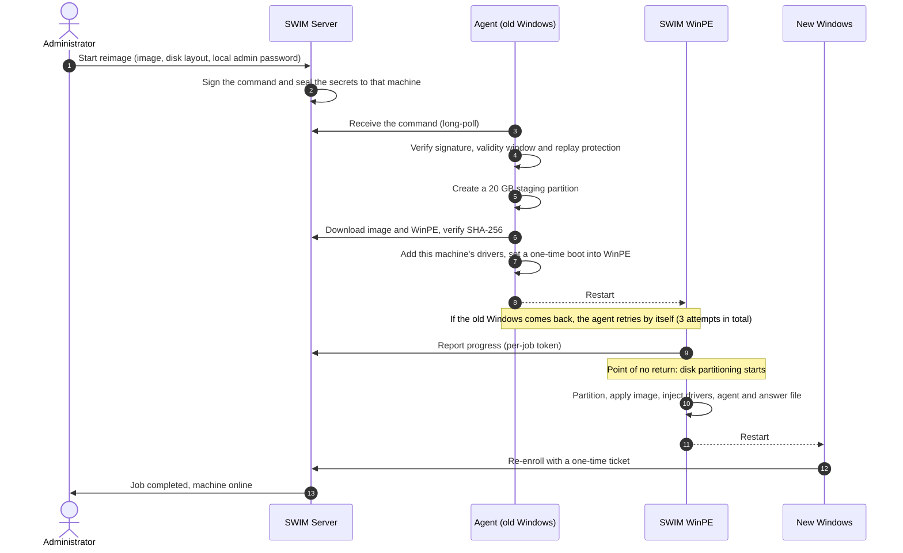

Job states:

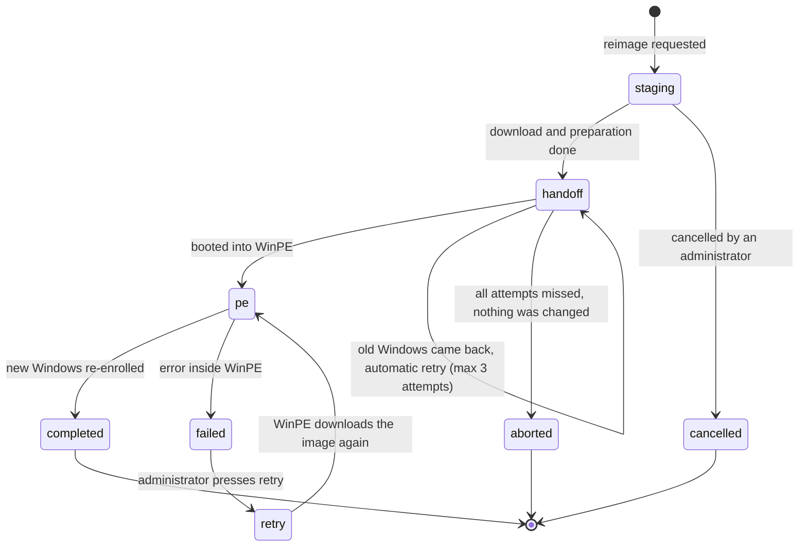

### Trust and security model

Clients run commands as SYSTEM, so there are several independent layers between the administrator,
the server and the clients.

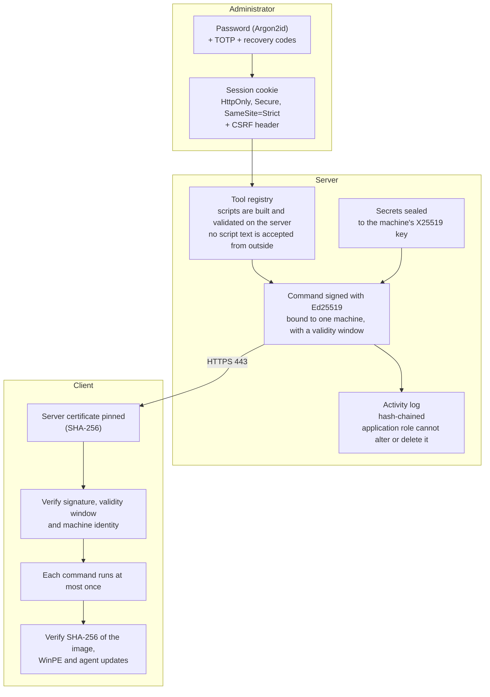

| Layer | Protection |
|---|---|
| Sign-in | Password plus TOTP. 5 failures suspend the account for 15 minutes, 20 failures from one IP suspend that IP for 15 minutes |
| Console | Content-Security-Policy blocks injected scripts, HSTS, no framing by other sites |
| Commands | Every command is signed, bound to one machine and expires. The agent never runs a command twice |
| Secrets | The local admin password is sealed to the target machine. Scheduled jobs store it encrypted (AES-256-GCM) |
| Files | Images, WinPE and agent updates are verified by SHA-256 before use |
| Audit | The log cannot be edited or deleted directly, and the console can verify the hash chain |

More detail: [docs/spec/08-security.md](docs/spec/08-security.md) and [docs/OPERATIONS.md](docs/OPERATIONS.md).

## Quick start

Requirements: Ubuntu 24.04 LTS with hardware virtualisation, 16 GB RAM or more, 100 GB of free disk
and a static IP address.

```bash
sudo mkdir -p /opt/swim && sudo chown "$USER" /opt/swim
git clone https://github.com/bluebox-dev/Swim.git /opt/swim
cd /opt/swim
./install.sh
```

The script installs the host packages, generates fresh secrets and a TLS certificate, configures
the firewall, builds and starts the stack, and prints how to sign in for the first time. The full
walkthrough, including building the first image, is in [docs/INSTALL.md](docs/INSTALL.md).

## Repository layout

```text
.
├── backend/                  Control plane (Go)
│   ├── cmd/server/           Entry point: API server, builder worker, waker, CLI
│   ├── internal/api/         REST API: auth, hosts, commands, deploy, schedules, tools, audit
│   ├── internal/builder/     Image capture: reseal (sysprep), offline checks, ISO import
│   ├── internal/audit/       Hash-chained activity log
│   ├── internal/signing/     Ed25519 command-signing key
│   ├── internal/vm/          libvirt wrapper for the golden master VM
│   ├── internal/wol/         Wake-on-LAN sender
│   ├── internal/msi/         Per-site agent installer (MSI) builder
│   ├── migrations/           PostgreSQL schema, applied automatically at start
│   └── tools/ntfs-unwof/     Helper that expands CompactOS (WOF) files before capture
├── agent/                    Windows agent (Go)
│   ├── cmd/swim-agent/       Service entry point
│   ├── internal/agent/       Enrollment, command loop, reimage, pre-staging, policy, remote session
│   └── install/              install.ps1 and Windows trust policy script
├── pe/cmd/swim-pe/           WinPE worker: partition, apply image, inject drivers and agent
├── pkg/
│   ├── manifest/             Signed command and job manifest formats shared by server and agent
│   └── wof/                  CompactOS (WOF) decompression
├── frontend/                 Admin console: plain HTML, CSS and JavaScript, no build step
├── builder-infra/
│   ├── docker-compose.yml    postgres, backend, builder, waker, nginx, guacd, guacamole
│   ├── nginx/                TLS, security headers, rate limits
│   ├── postgres/             Database role bootstrap
│   └── scripts/              Host setup, agent build, WinPE build, golden master, smoke test
├── docs/                     Installation and operations guides, specification, screenshots
├── install.sh                One-command installation for a fresh Ubuntu 24.04 server
├── LICENSE                   GNU AGPL v3
└── NOTICE                    Copyright and third-party notices
```

| Component | Language | Runs on | Purpose |
|---|---|---|---|
| `backend` | Go | Server (Docker) | API, signing, scheduling, audit log, image builder |
| `frontend` | HTML/CSS/JS | Browser | Administrator console |
| `agent` | Go | Client Windows (service) | Executes signed commands, stages and hands off reimage jobs |
| `pe` | Go | Client WinPE | Partitions the disk and installs the image |
| `pkg` | Go | Shared | Wire formats and CompactOS handling |

## What is not in this repository

Every secret is generated on the server at install time and never stored in Git.

| Not included | Location on the server | Created by |
|---|---|---|
| Database passwords, admin tokens, Guacamole secret | `builder-infra/.env` | `scripts/setup-host.sh` |
| Command-signing key (Ed25519) and schedule encryption key | `/srv/swim/keys/` | backend, on first start |
| TLS certificate and private key | `/srv/swim/certs/` | `scripts/setup-host.sh` |
| Database, images, Windows ISOs, built agent binaries | `/srv/swim/` and a Docker volume | normal use |

An example settings file is at [builder-infra/.env.example](builder-infra/.env.example).
You must supply your own Windows ISO under your organisation's licence.

## Documentation

| Document | Language |
|---|---|
| [Installation guide](docs/INSTALL.md): from an empty server to the first Windows install | English · [ไทย](docs/INSTALL.th.md) |
| [Operations guide](docs/OPERATIONS.md): updates, agent releases, backup, security, known issues | English · [ไทย](docs/OPERATIONS.th.md) |
| [Specification](docs/spec/README.md): 12 chapters covering architecture, agent, manifest, security, data model and API (the target design) | English · [ไทย](docs/spec/README.th.md) |
| [Windows trust policy](docs/deploy/windows-trust-policy.md): Group Policy settings so clients trust the server | Thai |
| [Builder internals](builder-infra/README.md): golden master and image capture details | Thai |

## License

Copyright (C) 2026 Thanakorn Kriangudom

Designed and developed by Thanakorn Kriangudom, with Claude (Anthropic) assisting with code,
security review and documentation.

Released under the [GNU Affero General Public License v3.0](LICENSE) (AGPL-3.0-or-later). See
[NOTICE](NOTICE) for the copyright notice. In short: you may use, modify and redistribute SWIM, but
if you run a modified version for others over a network, you must offer them the source of that
version under the same licence. The `LICENSE` file is the binding text.

The IBM Plex Sans Thai and IBM Plex Mono typefaces in `frontend/fonts/` are Copyright IBM Corp. and
used under the SIL Open Font License 1.1. Windows is a Microsoft product and requires its own licence.
