<div align="center">

[English](README.md) · **ไทย**

# SWIM — Staged Windows Image Manager

**ล้างเครื่องและติดตั้ง Windows ทั้งห้องคอมพิวเตอร์ผ่านเครือข่าย ไม่ต้องใช้ PXE หรือ USB**

*Reimage a whole Windows computer lab over the network — no PXE, no USB sticks.*

[](LICENSE)


[ติดตั้ง](#ติดตั้ง) · [ภาพหน้าจอ](#ภาพหน้าจอ) · [การออกแบบระบบ](#การออกแบบระบบ) · [คู่มือติดตั้ง](docs/INSTALL.th.md) · [คู่มือดูแลระบบ](docs/OPERATIONS.th.md)

</div>

SWIM สร้าง image ของ Windows จากเครื่องต้นแบบบน server แล้วสั่งล้างเครื่องและติดตั้งให้เครื่องลูก
ทีละเครื่อง ทีละห้อง หรือตามตารางเวลา เครื่องลูกดาวน์โหลด image เอง ตรวจความถูกต้อง
บูตเข้า WinPE ลง Windows แล้วกลับมาออนไลน์เองโดยไม่ต้องมีคนไปที่เครื่อง

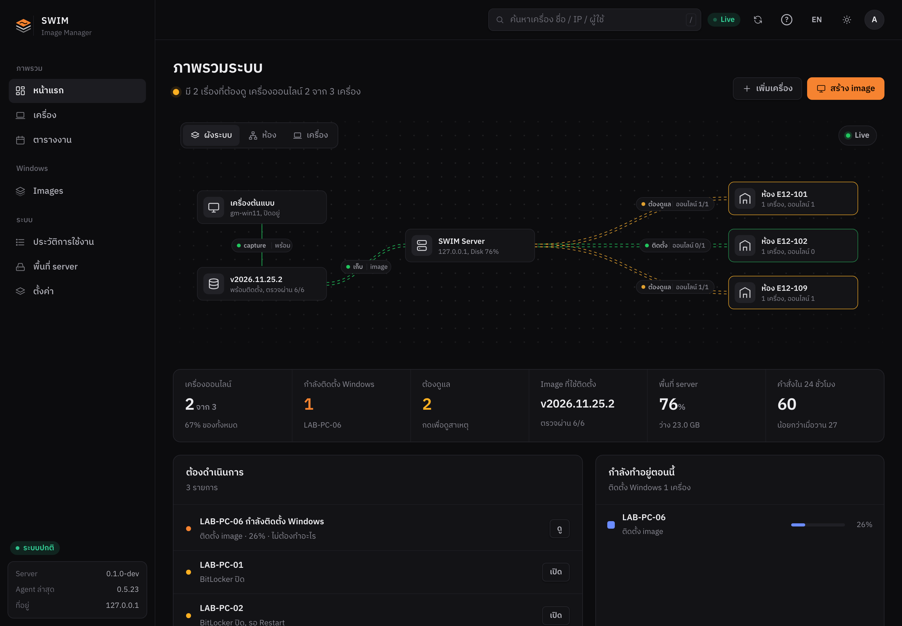

## สารบัญ

- [ทำอะไรได้](#ทำอะไรได้)
- [ภาพหน้าจอ](#ภาพหน้าจอ)
- [การออกแบบระบบ](#การออกแบบระบบ)
- [ติดตั้ง](#ติดตั้ง)
- [ส่วนเสริม (plugin)](#ส่วนเสริม-plugin)
- [โครงสร้างของ repository](#โครงสร้างของ-repository)
- [สิ่งที่ไม่อยู่ใน repository นี้](#สิ่งที่ไม่อยู่ใน-repository-นี้)
- [เอกสาร](#เอกสาร)
- [สัญญาอนุญาต](#สัญญาอนุญาต)

## ทำอะไรได้

- **สร้าง image** จากเครื่องต้นแบบ (Golden Master) ที่รันบน server หรือนำเข้าจาก ISO ของ Windows โดยตรง
  ระบบทำ sysprep ตรวจ image 6 ข้อ และรออนุมัติก่อนใช้งาน
- **ล้างเครื่องและติดตั้ง Windows** ผ่านเครือข่าย เครื่องลูกดาวน์โหลด image เอง ตรวจ SHA-256
  บูตเข้า WinPE ลง Windows แล้วกลับมาออนไลน์เอง
- **สั่งทีละหลายเครื่อง** ทั้งห้อง หรือตั้งเวลาล่วงหน้าในปฏิทิน และเก็บ image ไว้ในเครื่องล่วงหน้าได้
- **ดูแลเครื่อง** ด้วยเครื่องมือสำเร็จรูป 26 ตัว (ปิดเครื่อง, บัญชีผู้ใช้, โปรแกรม, Service, Windows Update, เครือข่าย, ดิสก์)
  Remote Desktop ในเบราว์เซอร์ Wake-on-LAN และนโยบายล็อกการติดตั้งโปรแกรม
- **ตรวจสอบย้อนหลังได้** ทุกการกระทำอยู่ในประวัติการใช้งานที่แก้ไขไม่ได้ เก็บ 90 วัน
- **ความปลอดภัย** เข้าระบบด้วยรหัสผ่านและแอปยืนยันตัวตน (TOTP) ทุกคำสั่งถึงเครื่องลูกถูกเซ็นด้วย Ed25519
- หน้าเว็บมีภาษาไทยและอังกฤษ ธีมมืดและสว่าง

## ภาพหน้าจอ

ภาพทั้งหมดถ่ายจากโปรแกรมจริง ชื่อเครื่อง ที่อยู่ IP และชื่อผู้ใช้ถูกแทนด้วยค่าตัวอย่าง

| | |
|---|---|
| **เข้าสู่ระบบ** รหัสผ่านและรหัสจากแอปยืนยันตัวตน | **แผนผังเครื่อง** แยกตามห้อง ลากเครื่องย้ายห้องได้ |
| 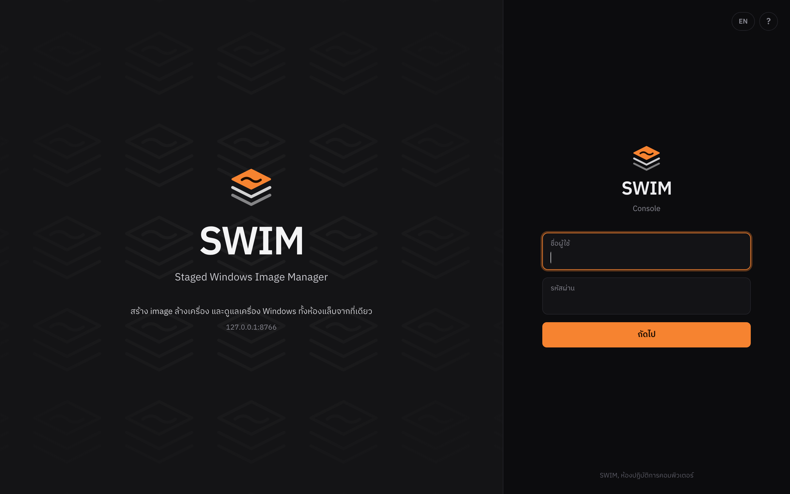 | 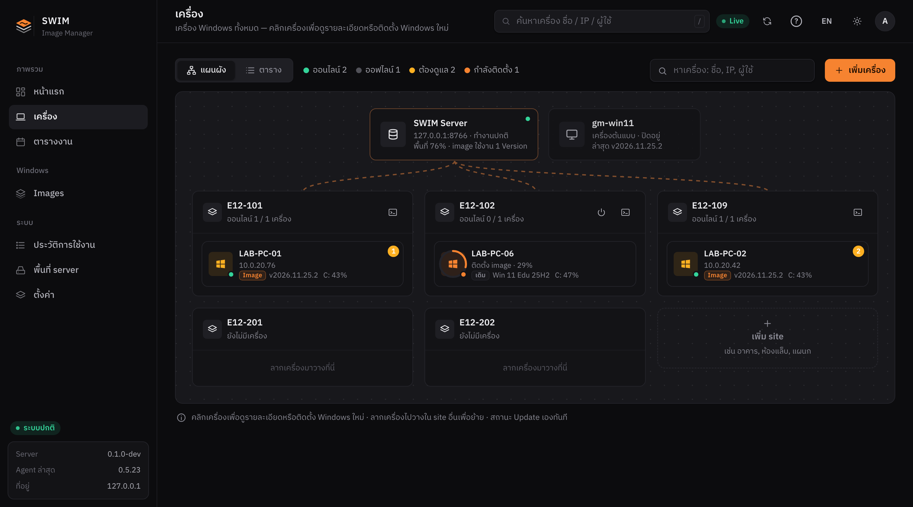 |
| **รายการเครื่อง** สถานะออนไลน์และ Windows ที่ติดตั้งอยู่ | **Images** ขั้นตอนสร้าง image จากเครื่องต้นแบบ |
| 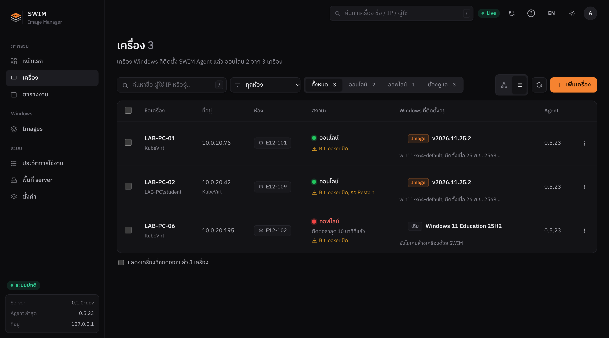 | 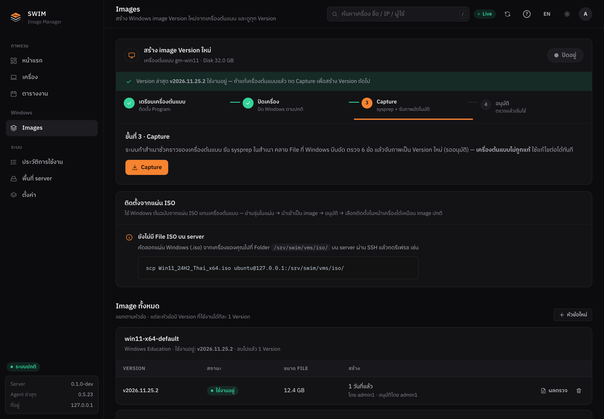 |
| **หน้าเครื่อง** นโยบายเครื่องและ image ที่เก็บไว้ | **เครื่องมือ** สคริปต์ถูกสร้างและตรวจบน server |
| 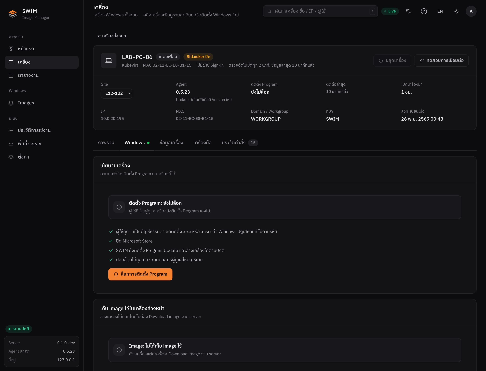 | 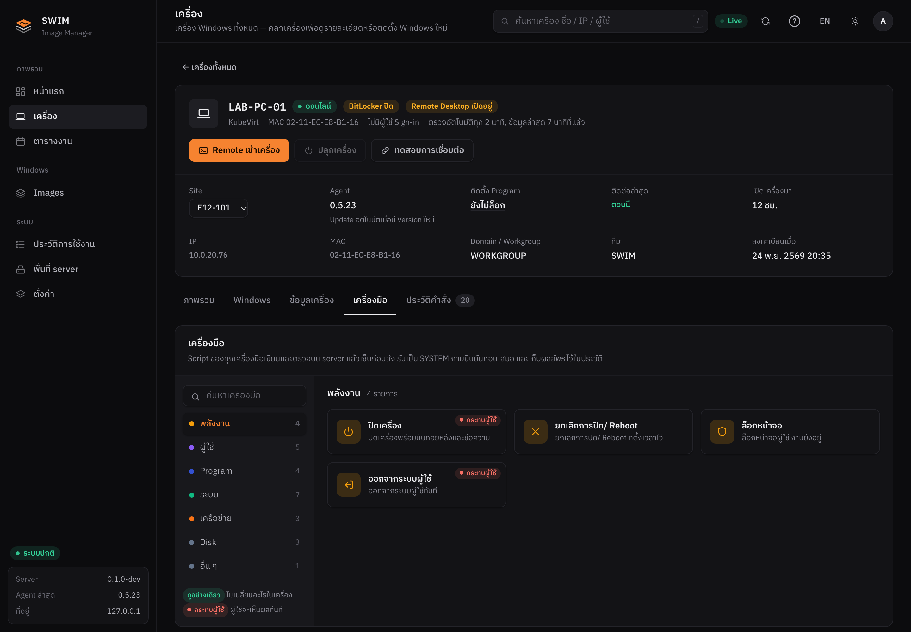 |
| **ตารางงาน** ตั้งเวลาล้างเครื่องล่วงหน้า | **ประวัติการใช้งาน** ใครทำอะไร กับเครื่องไหน เมื่อไหร่ |
| 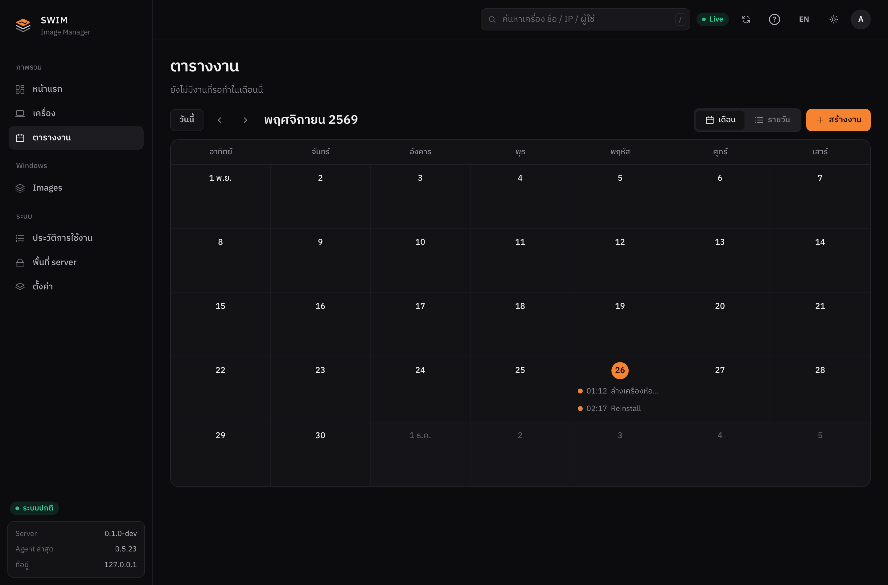 | 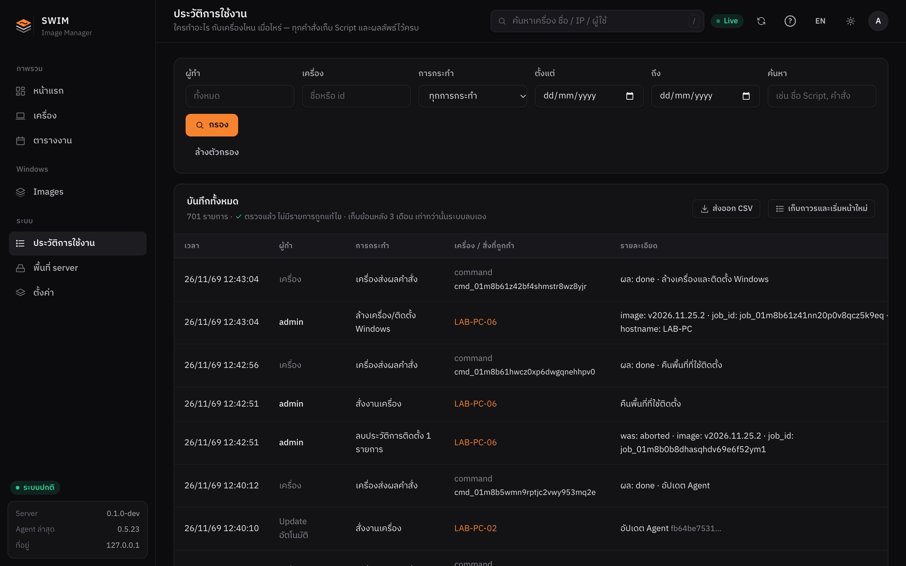 |

ธีมสว่าง:

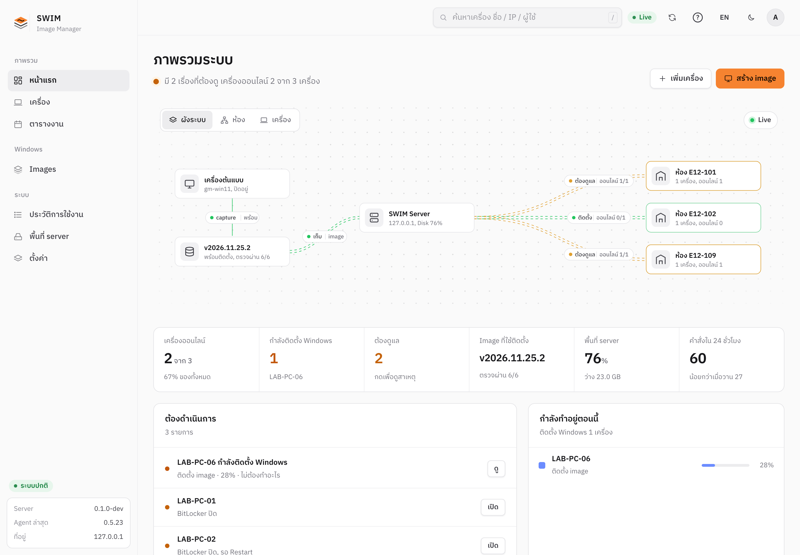

## การออกแบบระบบ

### ภาพรวมของส่วนประกอบ

Server เครื่องเดียวรันทุกอย่าง ส่วนควบคุมอยู่ใน Docker Compose และใช้ KVM/libvirt บนเครื่องเดียวกันสำหรับเครื่องต้นแบบ
เปิดสู่เครือข่ายเฉพาะพอร์ต 443 (และ 80 ที่ส่งต่อไป 443) บริการภายในไม่เปิดรับจากภายนอก
ทุกการเชื่อมต่อระหว่างเครื่องลูกกับ server เปิดโดย agent ของเครื่องลูกเอง เครื่องลูกจึงไม่ต้องเปิดพอร์ต และอยู่หลัง router (NAT) หรือ firewall ได้

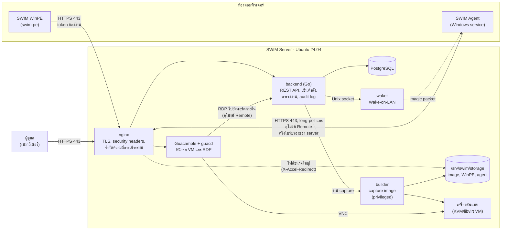

| บริการ | หน้าที่ | เครือข่าย |
|---|---|---|
| `nginx` | จุดเข้าเดียวของระบบ เสิร์ฟหน้าเว็บ ส่งต่อ API และเสิร์ฟ image ที่ backend อนุญาตแล้ว | 80, 443 |
| `backend` | API ทั้งหมด เซ็นคำสั่ง จัดตารางงาน เขียนประวัติการใช้งาน | `127.0.0.1:8090` |
| `postgres` | ฐานข้อมูล แอปใช้ role ที่แก้หรือลบประวัติการใช้งานไม่ได้ | เครือข่ายภายใน Docker |
| `builder` | ทำงาน capture image และ snapshot ของเครื่องต้นแบบ | ไม่มีพอร์ต |
| `guacamole`, `guacd` | แสดงหน้าจอเครื่องต้นแบบ (VNC) และ Remote Desktop ของเครื่องลูกในเบราว์เซอร์ | `:8080` (firewall ปิดจากภายนอก), `127.0.0.1:4822` |
| `waker` | ส่ง Wake-on-LAN จากเครือข่ายของ host | Unix socket |

### เส้นทางของ image

Image ทุกตัวต้องผ่านการอนุมัติก่อนติดตั้งได้ การ capture ทำบนสำเนาชั่วคราว เครื่องต้นแบบจึงไม่ถูกแก้

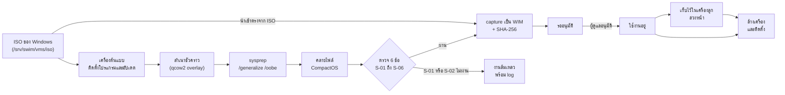

### ขั้นตอนล้างเครื่องและติดตั้ง

จนถึงจุดที่ WinPE เริ่มแบ่งดิสก์ ทุกอย่างย้อนกลับได้ ถ้าเกิดปัญหาก่อนหน้านั้นเครื่องจะกลับเข้า Windows เดิมโดยไม่มีอะไรถูกแก้

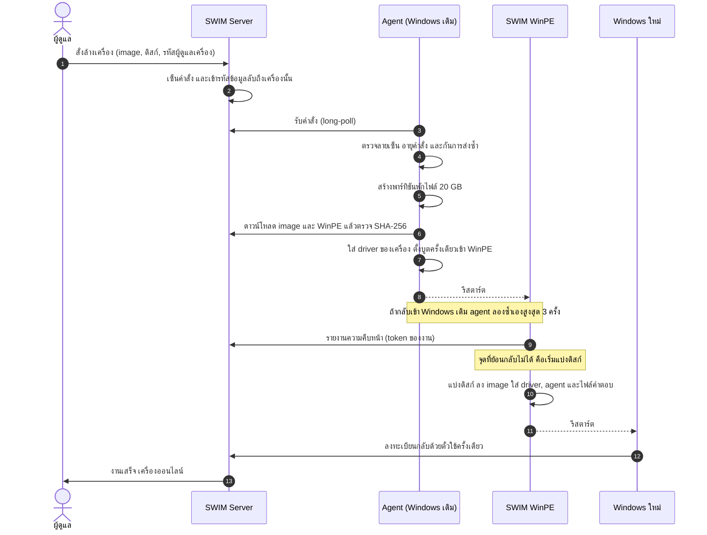

สถานะของงานติดตั้ง:

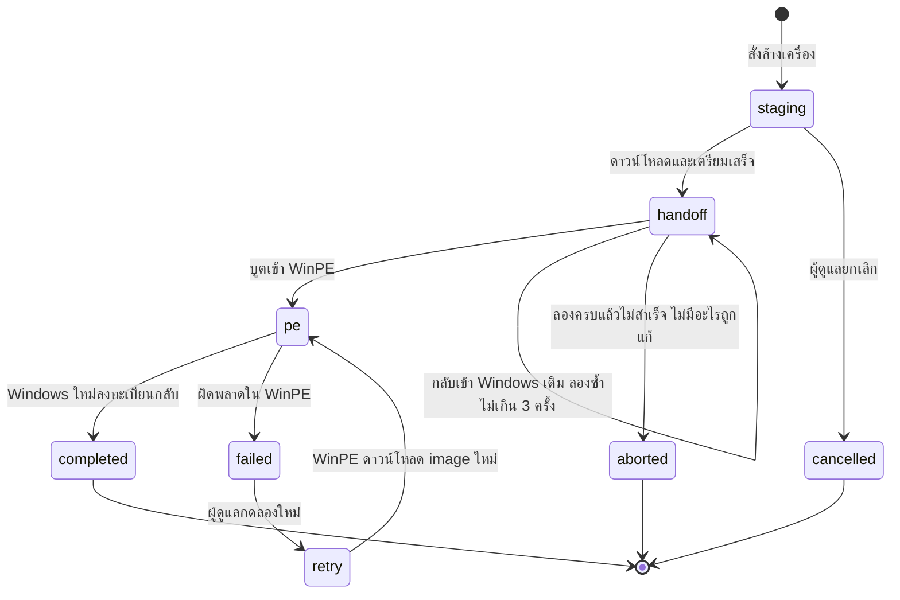

### ความเชื่อถือและความปลอดภัย

เครื่องลูกรันคำสั่งด้วยสิทธิ์ SYSTEM ระบบจึงมีการป้องกันหลายชั้นระหว่างผู้ดูแล server และเครื่องลูก

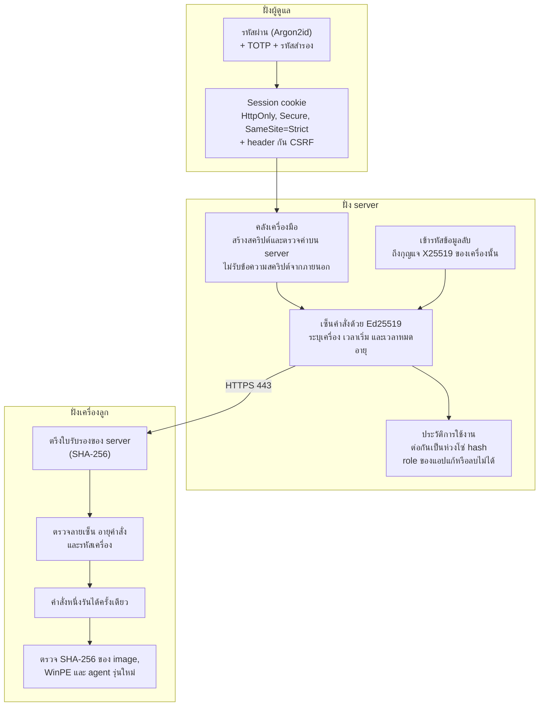

| ชั้น | การป้องกัน |
|---|---|
| เข้าระบบ | รหัสผ่านและ TOTP, ผิด 5 ครั้งบัญชีถูกพัก 15 นาที, ผิด 20 ครั้งจาก IP เดียวถูกพัก 15 นาที |
| หน้าเว็บ | Content-Security-Policy ห้ามสคริปต์แปลกปลอม, HSTS, ห้ามฝังใน iframe |
| คำสั่ง | เซ็นทุกคำสั่ง ระบุเครื่องปลายทางและเวลาหมดอายุ, agent ไม่รันคำสั่งซ้ำ |
| ข้อมูลลับ | รหัสผู้ดูแลเครื่องถูกเข้ารหัสถึงเครื่องปลายทาง งานที่ตั้งเวลาไว้เก็บรหัสแบบเข้ารหัส (AES-256-GCM) |
| Remote Desktop | รหัสผ่านใช้ครั้งเดียวเข้ารหัสถึงเครื่องนั้น บัญชีเปิดใช้ 10 นาที และเข้าถึงผ่านอุโมงค์ที่ agent เปิดออกมาเอง เครื่องลูกไม่เปิดพอร์ตรับจากเครือข่าย |
| ไฟล์ | image, WinPE และ agent ตรวจ SHA-256 ก่อนใช้ทุกครั้ง |
| ประวัติ | แก้หรือลบตรง ๆ ไม่ได้ ตรวจความครบถ้วนของห่วงโซ่ได้จากหน้าเว็บ |

รายละเอียดเพิ่มเติมอยู่ใน [docs/spec/08-security.th.md](docs/spec/08-security.th.md) และ [docs/OPERATIONS.th.md](docs/OPERATIONS.th.md)

## ติดตั้ง

ต้องมี Ubuntu 24.04 LTS ที่รองรับ virtualization, RAM 16 GB ขึ้นไป, ดิสก์ว่าง 100 GB ขึ้นไป และ IP คงที่

```bash
sudo mkdir -p /opt/swim && sudo chown "$USER" /opt/swim
git clone https://github.com/bluebox-dev/Swim.git /opt/swim
cd /opt/swim
./install.sh
```

สคริปต์ติดตั้งแพ็กเกจ สร้างรหัสลับชุดใหม่ สร้างใบรับรอง TLS ตั้ง firewall build และสตาร์ตระบบ
แล้วบอกวิธีเข้าใช้งานครั้งแรก ขั้นตอนทั้งหมดรวมถึงการสร้าง image แรกอยู่ใน [docs/INSTALL.th.md](docs/INSTALL.th.md)

## ส่วนเสริม (plugin)

ฟีเจอร์เสริมอยู่นอกระบบหลัก ในโฟลเดอร์ [`plugins/`](plugins/README.md) plugin จะถูกรวมเข้าไปใน
server และ agent ก็ต่อเมื่อสั่งเปิด ถ้า clone มาใหม่จะได้ระบบหลักอย่างเดียว

| Plugin | เพิ่มอะไร |
|---|---|
| [`exam`](plugins/exam/README.md) | โหมดสอบ: จำกัดเว็บ โปรแกรม และ USB เก็บข้อมูลระหว่างการสอบ และเก็บภาพหน้าจอเป็นหลักฐานเมื่อพบการทำผิด |

```bash
builder-infra/scripts/plugin.sh list
builder-infra/scripts/plugin.sh enable exam
builder-infra/scripts/plugin.sh disable exam
```

วิธีเขียน plugin ของตัวเองอยู่ใน [plugins/README.md](plugins/README.md)

## โครงสร้างของ repository

| ส่วน | โฟลเดอร์ | เนื้อหา |
|---|---|---|
| Server (control plane) | `backend/` | REST API, ฐานข้อมูล, เซ็นคำสั่ง, ตารางงาน, ประวัติการใช้งาน (Go) |
| หน้าเว็บ | `frontend/` | Console ของผู้ดูแล (HTML/CSS/JS ล้วน ไม่มีขั้น build) |
| Agent | `agent/` | บริการบน Windows ของเครื่องลูก รับคำสั่งที่เซ็นแล้วจาก server (Go) |
| WinPE worker | `pe/` | โปรแกรมที่รันใน WinPE เพื่อแบ่งดิสก์และลง image (Go) |
| ของใช้ร่วม | `pkg/` | รูปแบบคำสั่งและ manifest, ตัวคลายไฟล์ CompactOS |
| โครงสร้างพื้นฐาน | `builder-infra/` | Docker Compose, nginx, สคริปต์ติดตั้งและ build |
| เอกสาร | `docs/` | สเปค, คู่มือติดตั้ง, คู่มือดูแลระบบ, ภาพหน้าจอ |

## สิ่งที่ไม่อยู่ใน repository นี้

รหัสลับทุกตัวถูกสร้างใหม่บน server ตอนติดตั้ง และไม่ถูกเก็บใน Git

| สิ่งที่ไม่มี | อยู่ที่ไหนบน server | สร้างโดย |
|---|---|---|
| รหัสผ่านฐานข้อมูล, admin token, รหัสของ Guacamole | `builder-infra/.env` | `scripts/setup-host.sh` |
| กุญแจเซ็นคำสั่ง (Ed25519) และกุญแจเข้ารหัสตารางงาน | `/srv/swim/keys/` | backend ตอนสตาร์ตครั้งแรก |
| ใบรับรอง TLS และ private key | `/srv/swim/certs/` | `scripts/setup-host.sh` |
| ฐานข้อมูล, image, ISO ของ Windows, ไฟล์ agent ที่ build แล้ว | `/srv/swim/` และ Docker volume | การใช้งาน |

ตัวอย่างไฟล์ตั้งค่าอยู่ที่ [builder-infra/.env.example](builder-infra/.env.example)
ISO ของ Windows ต้องจัดหาเองตามสิทธิ์การใช้งานของหน่วยงาน

## เอกสาร

- [docs/INSTALL.th.md](docs/INSTALL.th.md) ติดตั้งตั้งแต่ server เปล่าจนสั่งติดตั้ง Windows เครื่องแรก
- [docs/OPERATIONS.th.md](docs/OPERATIONS.th.md) อัปเดตระบบ, ออก agent รุ่นใหม่, สำรองข้อมูล, ความปลอดภัย, ปัญหาที่รู้อยู่
- [docs/spec/](docs/spec/README.th.md) สเปคของระบบ 12 บท
- [docs/deploy/windows-trust-policy.md](docs/deploy/windows-trust-policy.md) ตั้งค่า GPO ให้เครื่องลูกเชื่อถือ server
- [builder-infra/README.md](builder-infra/README.md) รายละเอียดของ Builder และการ capture image

## สัญญาอนุญาต

Copyright (C) 2026 Thanakorn Kriangudom

ออกแบบและพัฒนาโดย Thanakorn Kriangudom โดยมี Claude (Anthropic) เป็นผู้ช่วยเขียนโค้ด ตรวจความปลอดภัย และจัดทำเอกสาร

เผยแพร่ภายใต้ [GNU Affero General Public License v3.0](LICENSE) (AGPL-3.0-or-later) ดูประกาศลิขสิทธิ์ใน [NOTICE](NOTICE)

สรุปสั้น ๆ: ใช้ แก้ไข และเผยแพร่ต่อได้ แต่ถ้าแก้ไขแล้วเปิดให้ผู้อื่นใช้งานผ่านเครือข่าย
ต้องเปิดซอร์สโค้ดฉบับที่แก้ไขให้ผู้ใช้เหล่านั้นภายใต้สัญญาเดียวกัน ข้อความในไฟล์ `LICENSE` คือเงื่อนไขที่มีผลจริง

ฟอนต์ IBM Plex Sans Thai และ IBM Plex Mono ใน `frontend/fonts/` เป็นของ IBM Corp.
ใช้ภายใต้ SIL Open Font License 1.1 และ Windows เป็นผลิตภัณฑ์ของ Microsoft ที่ต้องมีสิทธิ์การใช้งานของตัวเอง
